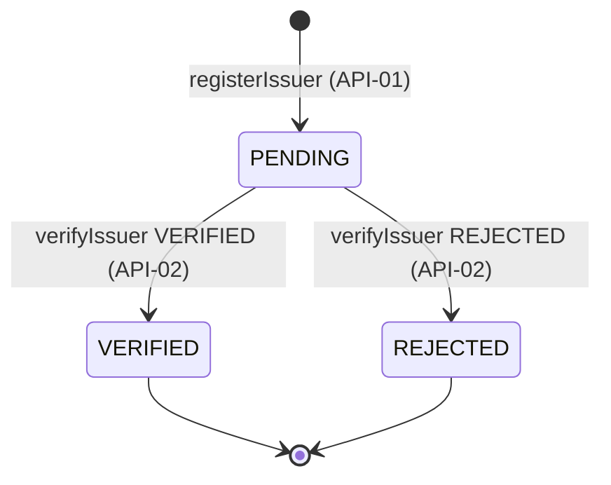

# BAB 4. PENGGUNA DAN HAK AKSES

## 4.1 Kategori Pengguna dan Aktor

Lettrust memiliki dua role aplikasi berakun (HR dan Admin), satu aktor tanpa akun (Pelamar), dan satu client sistem (Partner).

| Aktor | Jenis | Deskripsi | Area Akses |
| ----- | ----- | ----- | ----- |
| Pelamar | Pengguna tanpa akun | Kandidat penerima offer letter yang memeriksa surat. | Portal Karier Mitra (Simulasi) |
| Partner (Job Portal Mitra) | Client sistem | Platform yang mengonsumsi API-07 menggunakan token partner. | API-07 melalui server portal |
| HR (Perwakilan Perusahaan/HR) | Role aplikasi `HR` | Akun yang mendaftarkan perusahaan dan, setelah diotorisasi, menerbitkan serta mencabut bukti. | Lettrust Console — area Perusahaan/HR |
| Administrator Verifikasi | Role aplikasi `ADMIN` | Pihak independen yang meninjau penerbit dan mengotorisasi HR. | Lettrust Console — area Administrator |

Pemetaan ke participant SoaML D2: Pelamar ↔ Pelamar; Partner ↔ JobPortalPartner; HR ↔ EmployerHR; Admin ↔ VerificationAdministrator. Lettrust sebagai penyedia mencakup IssuerAdministration, OfferRegistry, VerificationPlatform, dan RiskAnalysis, dengan BlockchainRegistry sebagai komponen pendukung.

Role aplikasi menentukan akses fitur Lettrust. Role tidak dipilih oleh pengguna dan tidak dapat dikirim oleh client sebagai dasar otorisasi.

## 4.2 Persona Pengguna

### 4.2.1 Pelamar

| Aspek | Keterangan |
| ----- | ----- |
| Tujuan | Memastikan offer letter yang diterima dapat dipercaya sebelum menindaklanjutinya. |
| Kebutuhan | Pemeriksaan cepat tanpa akun, hasil yang mudah dipahami, kejelasan tentang apa yang diperiksa dan tidak diperiksa, serta panduan langkah berikutnya. |
| Aktivitas | Memilih mode, memasukkan kode, mengunggah PDF, memberikan persetujuan AI, membaca hasil. |
| Batasan | Tidak memiliki akses ke data penerbit selain nama penerbit pada bukti yang ditemukan. Tidak dapat memanggil API Lettrust secara langsung. |

### 4.2.2 HR (Perwakilan Perusahaan/HR)

| Aspek | Keterangan |
| ----- | ----- |
| Tujuan | Menyediakan bukti penerbitan yang dapat diperiksa pelamar dan mengendalikan status surat. |
| Kebutuhan | Proses registrasi yang jelas, status persetujuan yang transparan, penerbitan bukti yang cepat, kode yang mudah dibagikan, dan pencabutan yang aman. |
| Aktivitas | Registrasi akun dan perusahaan, memantau status, mengunggah PDF final, menyalin kode, melihat bukti, mencabut bukti. |
| Batasan | Hanya dapat mengelola bukti milik penerbitnya. Tidak dapat memverifikasi perusahaannya sendiri atau mengotorisasi dirinya sendiri. |

### 4.2.3 Administrator Verifikasi

| Aspek | Keterangan |
| ----- | ----- |
| Tujuan | Memastikan hanya penerbit terverifikasi dan HR berwenang yang dapat mencatat bukti. |
| Kebutuhan | Daftar penerbit menurut status, detail pengajuan, keputusan yang tercatat, dan otorisasi HR. |
| Aktivitas | Meninjau penerbit, menetapkan VERIFIED atau REJECTED dengan referensi bukti, mengotorisasi HR terafiliasi. |
| Batasan | Tidak dapat menerbitkan atau mencabut bukti, tidak dapat menjadi anggota penerbit, dan tidak dapat mengubah catatan blockchain. |

### 4.2.4 Partner (Job Portal Mitra)

| Aspek | Keterangan |
| ----- | ----- |
| Tujuan | Menyediakan fitur verifikasi offer letter kepada pengguna portal. |
| Kebutuhan | Satu API yang stabil, respons terstruktur, dan semantik hasil yang jelas. |
| Aktivitas | Mengumpulkan input dan persetujuan pelamar, memanggil API-07 dari server, menampilkan hasil. |
| Batasan | Tidak dapat menerbitkan, membaca daftar bukti, atau memanggil endpoint internal. Token tidak boleh diekspos ke browser. |

## 4.3 Model Identitas

| Identitas | Fungsi | Pengelolaan |
| ----- | ----- | ----- |
| User Identity (HR/Admin) | Autentikasi akun, role, afiliasi penerbit, dan kepemilikan resource. | Email dan password (di-hash), token sesi bertanda tangan. |
| Partner Identity | Autentikasi client API-07. | Token partner disimpan sebagai hash di Lettrust dan sebagai secret di server portal. |
| Registry Signer | Mengirim transaksi pencatatan dan pencabutan ke blockchain. | Kunci privat hanya tersedia di backend melalui konfigurasi environment; bukan role aplikasi. |
| Internal Service Identity | Autentikasi panggilan backend ke layanan AI internal. | Token internal pada konfigurasi environment. |

Registry Signer dan Internal Service Identity bukan role aplikasi, tidak dapat digunakan oleh pengguna, dan tidak memberikan hak akses kepada pengguna.

## 4.4 Lapisan Autentikasi dan Otorisasi

| Lapisan | Fungsi |
| ----- | ----- |
| Authentication | Memverifikasi token sesi pengguna atau token partner. |
| Role Authorization | Membatasi fitur berdasarkan role HR atau ADMIN. |
| Issuer State Authorization | Memastikan penerbit berstatus VERIFIED untuk operasi penerbitan dan pencabutan. |
| HR Authorization | Memastikan akun HR berstatus AUTHORIZED pada penerbitnya. |
| Resource Ownership | Membatasi akses bukti pada penerbit pemilik. |
| Partner Authorization | Membatasi token partner hanya pada API-07. |
| Internal Boundary | Endpoint `/internal/v1/*` hanya dapat dipanggil oleh backend Lettrust. |

Seluruh lapisan diterapkan di backend secara kumulatif. Keberhasilan autentikasi tidak berarti operasi berikutnya otomatis diizinkan. Penyembunyian menu pada antarmuka tidak menggantikan otorisasi backend.

## 4.5 Status Akun, Penerbit, dan Otorisasi

### 4.5.1 Status Penerbit

| Status | Makna | Hak Penerbitan |
| ----- | ----- | ----- |
| PENDING | Pengajuan diterima dan menunggu peninjauan. | Tidak ada |
| VERIFIED | Administrator menetapkan identitas penerbit terverifikasi (simulasi). | Ada bagi HR AUTHORIZED |
| REJECTED | Administrator menolak pengajuan. Status final pada D3. | Tidak ada |

Pencabutan status VERIFIED dan pengajuan ulang setelah REJECTED berada di luar cakupan D3.

### 4.5.2 Status Afiliasi dan Otorisasi HR

| Status | Makna |
| ----- | ----- |
| Tidak terafiliasi | Akun HR belum mendaftarkan atau terhubung dengan penerbit. Hanya dapat mendaftarkan perusahaan. |
| NOT_AUTHORIZED | Akun terafiliasi dengan penerbit tetapi belum diotorisasi. |
| AUTHORIZED | Akun diotorisasi Administrator untuk menerbitkan dan mencabut bukti atas nama penerbit VERIFIED. |

Pencabutan otorisasi HR berada di luar cakupan D3. Status otorisasi HR berbeda dari status bukti REVOKED.

### 4.5.3 Status Bukti (Ringkas)

| Status | Lokasi | Makna |
| ----- | ----- | ----- |
| PENDING | Off-chain | Pencatatan sedang diproses; kode belum diberikan kepada HR. |
| FAILED | Off-chain | Transaksi gagal; tidak ada bukti on-chain dan kode tidak berlaku. |
| ACTIVE | On-chain (sumber kebenaran) | Bukti tercatat dan berlaku. |
| REVOKED | On-chain (sumber kebenaran) | Bukti dicabut penerbit; riwayat penerbitan tetap ada. |

Detail lifecycle bukti dijelaskan pada BR-02 (Bab 8).

## 4.6 Matriks Hak Akses Fitur

Keterangan kolom: **Pel** = Pelamar; **Prt** = Partner; **HR-0** = HR tidak terafiliasi; **HR-N** = HR terafiliasi NOT_AUTHORIZED atau penerbit belum VERIFIED; **HR-A** = HR AUTHORIZED pada penerbit VERIFIED; **Adm** = Administrator.

| Fitur / Operasi | Pel | Prt | HR-0 | HR-N | HR-A | Adm |
| ----- | ----- | ----- | ----- | ----- | ----- | ----- |
| Membuka fitur verifikasi di portal | Ya | — | — | — | — | — |
| Memanggil API-07 verifyOffer | Tidak (melalui portal) | Ya | Tidak | Tidak | Tidak | Tidak |
| Registrasi akun HR | — | — | Ya | — | — | — |
| Login/logout Console | — | — | Ya | Ya | Ya | Ya |
| Mendaftarkan perusahaan (API-01) | — | — | Ya | Tidak | Tidak | Tidak |
| Melihat status penerbit sendiri | — | — | — | Ya | Ya | — |
| Melihat daftar seluruh penerbit | — | — | Tidak | Tidak | Tidak | Ya |
| Memutuskan verifikasi (API-02) | — | — | Tidak | Tidak | Tidak | Ya |
| Mengotorisasi HR (API-03) | — | — | Tidak | Tidak | Tidak | Ya |
| Menerbitkan bukti (API-04) | — | — | Tidak | Tidak | Ya | Tidak |
| Melihat daftar/detail bukti penerbit sendiri (API-05) | — | — | Tidak | Tidak | Ya | Tidak |
| Mencabut bukti penerbit sendiri (API-06) | — | — | Tidak | Tidak | Ya | Tidak |
| Melihat/mencabut bukti penerbit lain | — | Tidak | Tidak | Tidak | Tidak | Tidak |
| Memanggil `/internal/v1/*` (API-08, ekstraksi) | Tidak | Tidak | Tidak | Tidak | Tidak | Tidak |
| Mengakses kunci signer atau token internal | Tidak | Tidak | Tidak | Tidak | Tidak | Tidak |

Endpoint `/internal/v1/*` hanya dipanggil oleh backend Lettrust (VerificationPlatform). Administrator dapat melihat metadata bukti suatu penerbit hanya apabila fitur tersebut ditetapkan sebagai kebutuhan baru; pada D3 fitur tersebut tidak tersedia.

## 4.7 Kepemilikan dan Privasi Resource

| Resource | Aturan Akses |
| ----- | ----- |
| Akun pengguna | Pemilik akun; Administrator melihat identitas dasar HR terafiliasi pada detail penerbit. |
| Data penerbit | HR terafiliasi dan Administrator. |
| Bukti dan metadata off-chain | HR terotorisasi pada penerbit pemilik. Pelamar hanya menerima hasil verifikasi melalui API-07. |
| Catatan on-chain | Dapat dibaca melalui registry; tidak memuat data pribadi atau isi surat. |
| Berkas yang diunggah HR | Diproses untuk hash, tidak disimpan permanen. |
| Berkas yang diunggah pelamar | Diproses untuk hash dan ekstraksi selama permintaan berlangsung, tidak disimpan permanen. |
| Teks hasil ekstraksi | Hanya dikirim ke layanan AI internal dan penyedia model; tidak disimpan dan tidak dicatat di log. |
| Log verifikasi | Hanya enum hasil dan metadata teknis; tanpa isi berkas, teks, hash berkas pelamar, atau data pribadi. |

Permintaan yang tidak memiliki izin ditolak tanpa mengungkap isi maupun keberadaan resource milik penerbit lain.

## 4.8 Batas Akses Partner dan Pelamar

1. Pelamar berinteraksi hanya dengan portal mitra. Browser pelamar tidak menerima token partner.
2. Portal mitra meneruskan permintaan ke API-07 dari sisi server menggunakan token partner.
3. Portal mitra bertanggung jawab memperoleh persetujuan pemrosesan AI sebelum mengirim `includeRisk=true`.
4. Hasil yang diterima portal hanya berisi informasi verifikasi yang diperlukan, termasuk nama penerbit pada bukti yang ditemukan, tanpa data internal penerbit lainnya.
5. Token partner tidak memberikan akses ke endpoint selain API-07.
